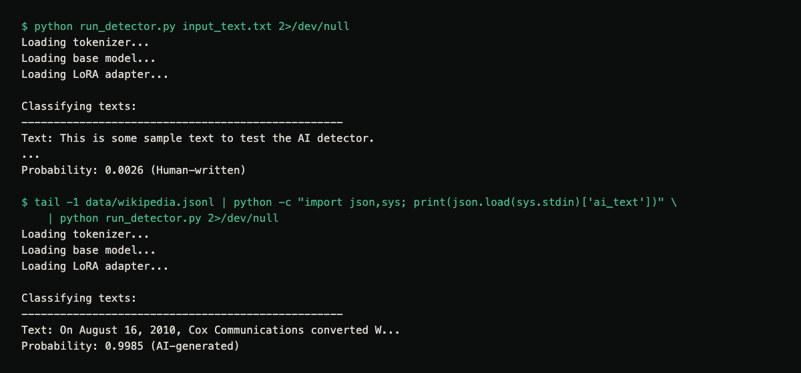
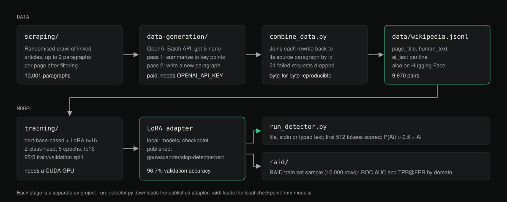

# AI Slop Detector


An end-to-end AI writing detector: a Wikipedia scraper, OpenAI Batch API data generation, LoRA fine-tuning of
`bert-base-cased`, a command-line classifier and a RAID benchmark analysis.

[Case study ↗](https://hellpuff.dev/work/ai-detector)

> **Provenance.** This repository is a copy of [gouwsxander/slop-detector](https://github.com/gouwsxander/slop-detector)
> (MIT, Copyright (c) 2025 Xander). The dataset and the trained adapter it uses are published on Hugging Face under
> [gouwsxander](https://huggingface.co/gouwsxander). "Our"/"we" below refers to that original work.

**Status:** research and educational code. The detector gives a probability estimate, not proof of authorship. Do not
use it to make decisions about people (see [Limitations](#limitations)).

## Demo



Real terminal capture: `run_detector.py` on the bundled `input_text.txt`, then on the AI-written half of the last row of
`data/wikipedia.jsonl` (a paragraph the model saw in training or validation, so this shows the script working, not
how well it generalizes). Hugging Face loading warnings on stderr are hidden with `2>/dev/null`. Setup is in
[Quick Start Script](#quick-start-script).

```console
$ python run_detector.py input_text.txt 2>/dev/null
Loading tokenizer...
Loading base model...
Loading LoRA adapter...

Classifying texts:
--------------------------------------------------
Text: This is some sample text to test the AI detector.
...
Probability: 0.0026 (Human-written)

$ tail -1 data/wikipedia.jsonl | python -c "import json,sys; print(json.load(sys.stdin)['ai_text'])" \
    | python run_detector.py 2>/dev/null
Loading tokenizer...
Loading base model...
Loading LoRA adapter...

Classifying texts:
--------------------------------------------------
Text: On August 16, 2010, Cox Communications converted W...
Probability: 0.9985 (AI-generated)
```

## Pipeline



Diagram of the stages in this repository and the files that connect them.

## Data
To train our classifier, we needed many examples of human-written text and AI-generated text.

### Human-written text
We gathered examples of human-written text by crawling and scraping Wikipedia.
- For each page seen, two random paragraphs were stored
- 10,001 paragraphs were stored in total
- Pages are visited in random order from a crawl stack seeded with popular pages and fed by each page's links
- Short, bullet-like, citation-like and lowercase-starting paragraphs are filtered out
- The code for crawling and scraping is contained in `/scraping`
- The result is in `/scrapes`.

### AI-generated text
AI text was then generated by prompting a model to rewrite each paragraph from Wikipedia.
- This was done in two passes with separate contexts: first summarize the paragraph into key points, then write a new
  encyclopedic paragraph from only the key points and the article title
- GPT 5 Nano was used because it is cheap, sufficient, and a member of the most popular model family
- The Batch API was used because it suited our use case
- The code for data generation is contained in `/data-generation`

### Full dataset
The final dataset with pairs of human-written and AI-generated text is available on [HuggingFace](https://huggingface.co/datasets/gouwsxander/wikipedia-human-ai).

It can also be found at `/data/wikipedia.jsonl` in this repository: 9,970 pairs, one JSON object per line with
`page_title`, `human_text` and `ai_text`. The 31 paragraphs whose summarize or rewrite request failed in the Batch API
(25 and 6) were dropped.

## Model
Our model is a LoRA adapter (r=16 on all linear layers, rank-stabilised) of `bert-base-cased`, with a two-class
classification head. Human and AI paragraphs are separate examples, shuffled and split 95/5 with seed 42.
- Validation accuracy: 96%. Re-checked with the published adapter on CPU: 964/997 = 96.7% on the 5% split rebuilt by
  `training/src/train.py`'s `get_datasets()` (see [docs/PRODUCTION_READINESS.md](docs/PRODUCTION_READINESS.md) for the caveat)
- Training was done with HuggingFace
- The code for training is contained in `/training`

### Usage
The final model weights are available on [HuggingFace](https://huggingface.co/gouwsxander/slop-detector-bert).

To use the model, you'll need to load the base BERT model and apply the LoRA adapter:

```python
from transformers import AutoTokenizer, AutoModelForSequenceClassification
from peft import PeftModel
import torch

# Load model
base_model_name = "google-bert/bert-base-cased"
lora_model_name = "gouwsxander/slop-detector-bert"

tokenizer = AutoTokenizer.from_pretrained(base_model_name)
base_model = AutoModelForSequenceClassification.from_pretrained(base_model_name, num_labels=2)
model = PeftModel.from_pretrained(base_model, lora_model_name)
model.eval()

# Classify text
text = "Your text here"
inputs = tokenizer([text], return_tensors="pt", truncation=True, max_length=512, padding=True)

with torch.no_grad():
    outputs = model(**inputs)
    probabilities = torch.nn.functional.softmax(outputs.logits, dim=-1)

ai_probability = probabilities[0, 1].item()
print(f"AI probability: {ai_probability:.4f}")  # > 0.5 = AI-generated
```

#### Quick Start Script
A ready-to-use script is provided in `run_detector.py`. It needs Python 3.11 or newer (CI and the commands below were
run with 3.12) and network access to the Hugging Face Hub on the first run. To run it:

1. Set up a virtual environment and install dependencies:
   ```
   python -m venv .venv && source .venv/bin/activate
   pip install -r requirements.txt
   ```

2. Run the script with text input:
   - From file: `python run_detector.py input_text.txt` (the whole file is classified as one text)
   - From stdin: `cat your_text.txt | python run_detector.py`
   - Interactive: `python run_detector.py`, type or paste the text, then press Enter on an empty line (or Ctrl-D).
     If you enter nothing, three built-in example sentences are classified instead.

   A missing or empty input file exits with status 1 before any model is loaded.

The first run downloads `bert-base-cased` (~436 MB) and the LoRA adapter (~11 MB) from Hugging Face into the
standard Hugging Face cache (`HF_HOME`); later runs work offline with `HF_HUB_OFFLINE=1`.
Neither the base model nor the adapter is stored in this repository.

Example (real output from `python run_detector.py input_text.txt`):
```
Classifying texts:
--------------------------------------------------
Text: This is some sample text to test the AI detector.
...
Probability: 0.0026 (Human-written)
```

Texts with probability > 0.5 are estimated to be AI-generated. Input longer than 512 tokens is truncated, so only
the beginning of a long text is scored.

You may see warnings about model loading and weights (the base model's `classifier.*` weights are reported as
missing); these are normal: the classifier head is loaded from the LoRA adapter right after. On Linux without a GPU, install
CPU-only torch first (`pip install torch --index-url https://download.pytorch.org/whl/cpu`) to avoid the multi-GB
CUDA wheels.

## Benchmark Performance and Limitations
We test our model on the [RAID benchmark](https://github.com/liamdugan/raid) training set to get a sense of the model's limitations.

### RAID Benchmark Performance
Our model performed better than random guessing (ROC AUC > 0.5) across all model families and all domains, though only
barely for arXiv abstracts (AUC 0.55), indicating that some general, transferable properties of AI-generated writing were learned.

TPR@FPR=1% per domain, recomputed from the committed `raid/analysis/predictions_10000.csv` (`take_max` aggregator,
the one `run_analysis.py` plots; checked by `tests/test_raid_analysis.py`):

| Domain | TPR@FPR=1% | TPR@FPR=5% | ROC AUC |
|---|---|---|---|
| reviews | 86.5% | 90.0% | 0.97 |
| wiki | 35.2% | 45.2% | 0.80 |
| abstracts | 31.9% | 37.9% | 0.55 |
| news | 26.3% | 37.1% | 0.76 |
| books | 19.4% | 61.9% | 0.86 |
| recipes | 7.7% | 16.2% | 0.67 |
| poetry | 2.2% | 30.8% | 0.59 |
| reddit | 0.7% | 5.2% | 0.77 |

Caveat: the 10,000-row sample contains only 277 human-written texts (about 35 per domain), so a 1% false-positive
rate cannot really be resolved per domain; treat the TPR@FPR=1% column as very noisy.

Text generated by LLaMA was the most likely to be detected.

The code and results for this analysis is contained in `/raid`.

### Limitations
This model has several important limitations:
- It produces a probability, not proof; false positives on human writing are expected, so it must not be used on its own to accuse anyone
- Our dataset contains only Wikipedia-style text
- Our dataset contains only generations from GPT 5 Nano
- We assume Wikipedia is currently entirely human-generated
- The model has a context window of 512 tokens
- It was trained on one paragraph of text at a time

## Repository layout and size
The repository is ~14 MB because it versions the **data**, not model weights: `data-generation/tmp/` holds the raw
OpenAI Batch API inputs/outputs (~47 MB uncompressed), `data/wikipedia.jsonl` (~10 MB) is the final dataset,
`scrapes/` the raw Wikipedia scrape (~5 MB) and `raid/analysis/predictions_10000.csv` (~1.3 MB) the benchmark
predictions. No model weights or binaries are committed. `python src/combine_data.py` (run from `data-generation/`)
regenerates `data/wikipedia.jsonl` byte-for-byte from the committed batch outputs, which is why they are kept.

Each stage (`scraping/`, `data-generation/`, `training/`, `raid/`) is a separate [uv](https://docs.astral.sh/uv/)
project with its own `pyproject.toml` and `uv.lock`; run them from inside their directory (`uv run src/<script>.py`).
- `data-generation/` needs an OpenAI API key in `OPENAI_API_KEY` (or a git-ignored `data-generation/.env`, see `.env.example`) and costs money.
- `training/` expects a CUDA GPU and writes checkpoints to `models/` (git-ignored).
- The stages pin their own Python (`.python-version`: 3.11.4 for data-generation and training, 3.13.1 for raid, 3.14 for
  scraping); uv downloads it if needed.
- `raid/` expects the RAID training CSV at `raid/raid-dataset/train_none.csv` (git-ignored, download from the RAID project) and a local checkpoint in `models/`.

## Testing
```
pip install -r requirements-dev.txt
python -m pytest
```
Expected: `28 passed`. CI runs the same suite on Ubuntu with Python 3.12 and CPU-only torch. The suite covers input handling of `run_detector.py`, the data-generation batch-file builder and API-key lookup,
the scraper's paragraph filter, the RAID aggregators and analysis helpers. The inference test uses a tiny,
randomly initialised stand-in BERT (`hf-internal-testing/tiny-random-BertForSequenceClassification`) to exercise
the code path only; it needs network access to the Hugging Face Hub and says nothing about detection quality.
`test_inference.py` at the repo root is a smoke script for the real model (`python test_inference.py`), not part of the suite.
See [docs/PRODUCTION_READINESS.md](docs/PRODUCTION_READINESS.md) for what has and has not been verified.

## Security and contributing
Report vulnerabilities privately as described in [SECURITY.md](SECURITY.md). The data-generation scripts read an
OpenAI key from `OPENAI_API_KEY` or a git-ignored `.env`; never commit it. Contribution rules, including "every
README number must come from a command you ran", are in [CONTRIBUTING.md](CONTRIBUTING.md). Changes are listed in
[CHANGELOG.md](CHANGELOG.md).

## License
MIT, see [LICENSE](LICENSE). It keeps the upstream copyright notice (Xander, 2025) alongside this copy's.
